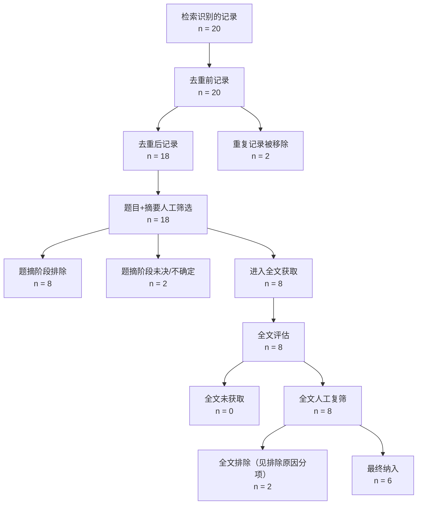

# PRISMA 2020 流程图（Identification → Screening → Included）

- 项目：analyte=BPA country=China periods=3 regions=7 config_version=2.0.0

## 数字核对表

| 阶段 | 恒等式 | 数值 |
|---|---|---|
| identification | records_identified_total = records_after_dedup + duplicates_removed | 20 = 18 + 2 |
| screening | ta_screened = ta_excluded + ta_uncertain_unresolved + ta_proceeded_fulltext | 18 = 8 + 2 + 8 |
| retrieval | fulltext_assessed = fulltext_retrieved + fulltext_unavailable | 8 = 8 + 0 |
| included | fulltext_retrieved = fulltext_excluded + fulltext_included | 8 = 2 + 6 |

## 各指标数值

| metric | value |
|---|---|
| records_identified_total | 20 |
| records_after_dedup | 18 |
| duplicates_removed | 2 |
| ta_screened | 18 |
| ta_excluded | 8 |
| ta_uncertain_unresolved | 2 |
| ta_proceeded_fulltext | 8 |
| fulltext_assessed | 8 |
| fulltext_unavailable | 0 |
| fulltext_retrieved | 8 |
| fulltext_excluded | 2 |
| fulltext_included | 6 |

> 被排除的记录不物理删除（见 excluded_studies.csv）；GATE-S2c 由人工确认后，纳入清单方可进入 S3。